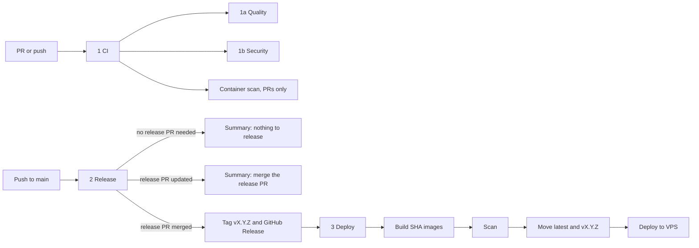

# CI and release pipelines

The sidebar in the Actions tab sorts by name, so the numbers show the order of work.

| # | Workflow | Runs on | Does |
| --- | --- | --- | --- |
| 1 | CI (`pipeline.yml`) | PR to `main`, push to `main`, Monday schedule | Calls 1a and 1b, and scans container images on PRs |
| 1a | Quality (`quality.yml`) | Called by 1 | Lint, tests, build for API and app; Playwright E2E |
| 1b | Security (`security.yml`) | Called by 1 | `npm audit`, CodeQL, secret scan, SBOM |
| 2 | Release (`release.yml`) | Push to `main` | release-please: opens or updates the release PR; on merge, tags and calls 3 |
| 3 | Deploy (`deploy.yml`) | Called by 2, or run by hand | Builds and pushes images, scans them, moves `latest`, deploys to the VPS |
| - | PR Dependency Review | PR to `main` | Fails on high-severity dependency changes |
| - | Claude Code | `@claude` mentions | Runs Claude on issues and PRs |

## Flow

## When does something reach the VPS?

Only when a release PR is merged. A push to `main` that is not a release merge does not deploy. Commit types `feat`, `fix`, `perf`, `refactor` and `revert` make a release. `docs`, `chore`, `ci`, `test`, `style` and `build` do not.

Each Release run writes its outcome to the run summary: released, release PR updated, or nothing to release.

## Waiting for manual action

- Deploy runs in the `production` environment. It has no required reviewers, so it runs without a pause. Adding a reviewer there makes Deploy wait for approval.
- Release PRs are opened by `GITHUB_TOKEN`. GitHub does not start workflows for those PRs, so CI does not run on them until someone pushes to the branch or closes and reopens the PR.

## Caching

- npm: `setup-node` caches for both lockfiles.
- Playwright browsers: cached per `app/package-lock.json`.
- Docker: BuildKit `type=gha` cache per image. Both Dockerfiles install dependencies from the lockfile before copying source, so source-only changes reuse the install layer.
- Trivy DB: cached per run, falling back to the most recent restore key.
- PRs read the Docker cache but never write it. Only Deploy, which runs on `main`, writes it.
