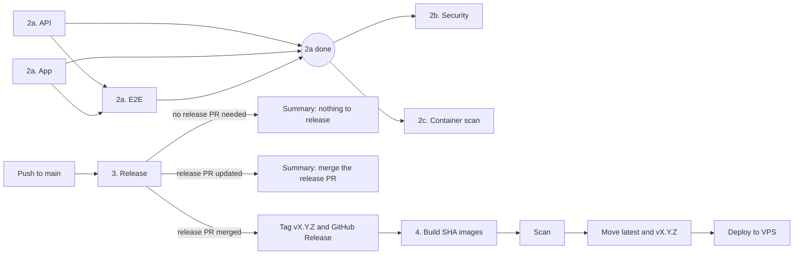

# CI and release pipelines

Workflow files and names are numbered in the order work happens. The Actions sidebar sorts by name, so the numbers are what keep the order.

| Number | File | Runs on | Does |
| --- | --- | --- | --- |
| 1. | `1.dependency-review.yml` | PR to `main` | Fails on high-severity dependency changes |
| 2. | `2.ci.yml` | PR and push to `main`, Monday schedule | Calls 2a and 2b; on PRs also runs 2c |
| 2a. | `2a.quality.yml` | Called by 2 | Lint, tests and build for API and app; E2E waits for both |
| 2b. | `2b.security.yml` | Called by 2, after 2a | `npm audit`, CodeQL, secret scan, SBOM |
| 2c. | container scan (in `2.ci.yml`) | PRs, after 2a | Builds both images and scans them with Trivy |
| 3. | `3.release.yml` | Push to `main` | release-please: opens or updates the release PR; on merge, tags and calls 4 |
| 4. | `4.deploy.yml` | Called by 3, or run by hand | Builds SHA images, scans them, then moves `latest` and `vX.Y.Z`, then deploys to the VPS |

## Flow

## When does something reach the VPS?

Only when a release PR is merged. A push to `main` that is not a release merge does not deploy. Commit types `feat`, `fix`, `perf`, `refactor` and `revert` make a release. `docs`, `chore`, `ci`, `test`, `style` and `build` do not.

Each Release run writes its outcome to the run summary: released, release PR updated, or nothing to release.

## Waiting for manual action

- Deploy runs in the `production` environment. It has no required reviewers, so it runs without a pause. Adding a reviewer there makes Deploy wait for approval.
- Release PRs are opened by `GITHUB_TOKEN`. GitHub does not start workflows for events that token creates, so CI does not run on those PRs until someone pushes to the branch.

## Caching

- npm: `setup-node` caches for both lockfiles.
- Playwright browsers: cached per `app/package-lock.json`.
- Docker: BuildKit `type=gha` cache per image. Both Dockerfiles install dependencies from the lockfile before copying source, so source-only changes reuse the install layer.
- Trivy DB: cached per run, falling back to the most recent restore key.
- PRs read the Docker cache but never write it. Only Deploy, which runs on `main`, writes it.

## Code scanning names

- Trivy results show as `2b. Trivy - secrets`, `2c. Trivy - api image`, `2c. Trivy - app image` on PRs and `4. Trivy - ...` on releases. The names come from rewriting the SARIF tool name before upload.
- CodeQL is always named `CodeQL` by GitHub. Its category is `2b-codeql`, which shows in the Security tab.
